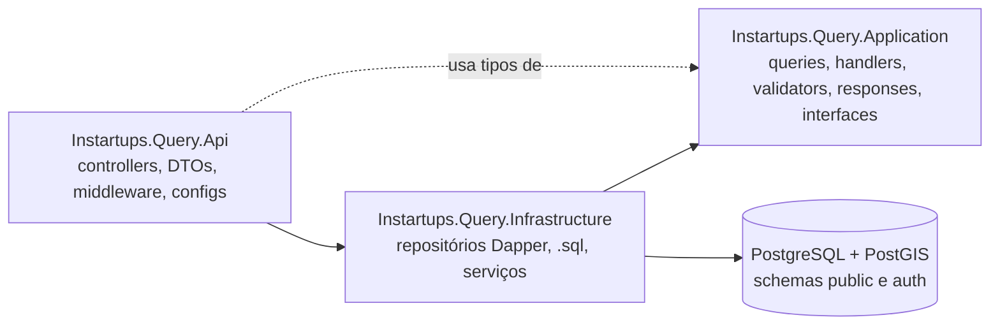
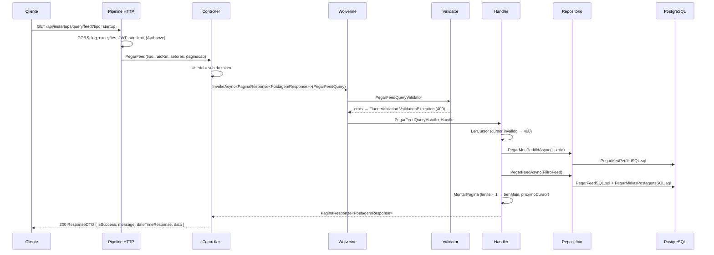

# Arquitetura

[← Índice](README.md)

## Camadas



| Projeto | Depende de | Conteúdo |
| --- | --- | --- |
| `Instartups.Query.Api` | Infrastructure (e, por transitividade, Application) | `Program.cs`, `Controllers/`, `DTOs/` (`ResponseDTO<T>`, `PaginacaoDTO`, `ValidationErrorDTO`), `Middleware/ExceptionsMiddleware.cs`, `Configurations/` (um arquivo por preocupação), `wwwroot/` (favicon e configuração do Scalar). |
| `Instartups.Query.Application` | Dapper, FluentValidation | `UseCases/` (uma pasta por consulta), `Common/` (constantes, enums, models, responses, cursores e validators compartilhados), `Interfaces/` (contratos implementados na Infrastructure), `Exceptions/`. |
| `Instartups.Query.Infrastructure` | Application, Npgsql, `Microsoft.AspNetCore.App` | `Persistence/` (`DatabaseConfig`, `DbConnectionFactory`, `Repositories/`, `Queries/*.sql`), `Service/` (`PaginadorService`, `PegarContextoRequisicaoService`, `LerArquivosSQLService`), `Configurations/DependencyInjection.cs`. |

Não há camada `Domain`. Os enums continuam no namespace `Instartups.Query.Domain.Enums` (e os mapeadores em `Instartups.Query.Domain.Enums.Mapear`), mas os arquivos ficam em `Application/Common/Enums/`, herança de quando a camada existia.

## Fluxo de uma requisição



1. **Controller** (`Api/Controllers/`): lê rota e query string, pega o `UserId` em `IPegarContextoRequisicaoService` e monta a query. Valores padrão (`tipo = "todos"`, `termo = ""`, `setores = []`, `limite = 20`) são aplicados aqui.
2. **Wolverine** (`IMessageBus.InvokeAsync<TResponse>`): encontra o handler pelo tipo da query e roda antes o validator FluentValidation correspondente.
3. **Handler** (`UseCases/<Caso>/<Caso>QueryHandler.cs`): decodifica o cursor, resolve o perfil do usuário, monta o filtro e chama os repositórios. Não há regra de escrita, só regras de leitura (visibilidade, filtros, paginação).
4. **Repositório** (`Infrastructure/Persistence/Repositories/`): abre uma conexão do pool (`NpgsqlDataSource`), lê o `.sql` embutido e executa com Dapper. Cada método abre e fecha a própria conexão.
5. **Response**: o handler converte os *models* (formato do banco) em *responses* (formato da API) com métodos estáticos `FromModel`, que também traduzem os enums inteiros em códigos (`1` → `"STARTUP"`).
6. **Controller** embrulha o resultado em `ResponseDTO<T>.Success(mensagem, data)`.

Erros em qualquer ponto viram exceções tratadas pelo `ExceptionsMiddleware`. Veja [Validações e erros](VALIDACOES-E-ERROS.md).

## Pipeline HTTP

Ordem em `Program.cs`:

```csharp
builder
    .AddSerilogConfig()          // Serilog lendo a seção "Serilog"
    .AddWolverineConfig();       // mediator + FluentValidation

builder.Services.AddInfrastructureDependencyInjection(builder.Configuration);

builder.Services
    .AddControllersConfig()      // JSON, 406, resposta de ModelState inválido
    .AddLowerCaseConfig()        // URLs e query strings geradas em minúsculas
    .AddAuthenticationConfig()   // JWT RS256
    .AddAuthorizationConfig()    // política Admin (não usada)
    .AddCorsConfigurations()     // política FRONTEND
    .AddRateLimiterConfig()      // token bucket por usuário
    .AddOpenApiConfig();         // documento v1

app.UseCors(OrigensCorsConst.Frontend);
app.UseSerilogConfig();          // log por requisição
app.UseExceptionsMiddleware();   // exceção → ResponseDTO + status
if (Development) app.UseOpenApiConfig();   // /openapi/v1.json e /docs
else { app.UseHsts(); app.UseHttpsRedirection(); }
app.UseAuthentication();
app.UseRateLimiter();            // depois da autenticação: particiona pelo usuário
app.UseAuthorization();
app.MapControllers();
```

O rate limiter fica **depois** da autenticação para conseguir ler o `sub` do token e dar um balde para cada usuário.

## Injeção de dependência

`Infrastructure/Configurations/DependencyInjection.cs`:

| Serviço | Implementação | Tempo de vida |
| --- | --- | --- |
| `NpgsqlDataSource` | `NpgsqlDataSourceBuilder(PostgresConnection).Build()` | Singleton (pool de conexões) |
| `IDbConnectionFactory` | `DbConnectionFactory` | Singleton |
| `LerArquivosSQLService` | — | Singleton (cache dos `.sql`) |
| `IPaginadorService` | `PaginadorService` | Singleton |
| `IPegarContextoRequisicaoService` | `PegarContextoRequisicaoService` | Scoped |
| `IPerfilRepository` | `PerfilRepository` | Scoped |
| `IPostagemRepository` | `PostagemRepository` | Scoped |

Handlers e validators não são registrados à mão: o Wolverine os descobre no assembly da Application (`Discovery.IncludeAssembly(typeof(IQuery).Assembly)`).

`DatabaseConfig` também liga `Dapper.DefaultTypeMap.MatchNamesWithUnderscores = true`, então a coluna `autor_tipo_perfil` preenche a propriedade `AutorTipoPerfil` sem `AS` em PascalCase.

## Usuário autenticado

`PegarContextoRequisicaoService.UserId` lê a claim `ClaimTypes.NameIdentifier` (o `sub` do JWT, mapeado pelo handler JWT do ASP.NET Core). Se ela faltar, não for GUID ou for `Guid.Empty`, lança `UsuarioNaoIdentificadoException` → `401`.

O `UserId` é o id do **usuário** na Auth. A maioria dos handlers o converte em id do **perfil** com `PegarMeuPerfilIdAsync` (`PegarMeuPerfilIdSQL.sql`), porque curtidas, seguidores e distâncias são relações entre perfis.

`UserName`, `Email` e `PhoneNumber` também existem no serviço, mas nenhuma query os usa.

## Padrões

### Estrutura de um caso de uso

```
UseCases/PegarFeed/
├── PegarFeedQuery.cs            # record com os parâmetros (implementa IQuery ou IPaginadaQuery)
├── PegarFeedQueryValidator.cs   # AbstractValidator ou PaginadaQueryValidator<T>
├── PegarFeedQueryHandler.cs     # IQueryHandler<TQuery, TResponse>
├── <Caso>Response.cs            # formato devolvido (quando não é um response comum)
├── Models/                      # formato que vem do banco (só colunas do SELECT)
└── Filtros/                     # parâmetros do SQL (FiltroXxx) e cursor (XxxCursor)
```

Regras de nomes e localização:

- **Model** = exatamente o que o `SELECT` devolve, com tipos do banco (enums como `int`, datas como `DateTime`/`DateTimeOffset`). Fica em `UseCases/<Caso>/Models/` ou na raiz da pasta do caso; se for usado por mais de um caso, vai para `Common/Models/`.
- **Filtro** = objeto passado direto ao Dapper como parâmetros do SQL. Os nomes das propriedades são os nomes dos parâmetros (`@MeuPerfilId`, `@CursorData`…).
- **Cursor** = record serializado no `proximoCursor`. Compartilhado em `Common/Filtros/` (`PostagemCursor`) ou próprio do caso (`PerfilBuscaCursor`).
- **Response** = formato público, com enums traduzidos para código. Compartilhado em `Common/Response/` quando dois casos devolvem o mesmo item (`PostagemResponse` no feed, nas postagens do perfil e na postagem avulsa).

### Casos de uso existentes

| Caso de uso | Query | Response | Repositório |
| --- | --- | --- | --- |
| `PegarMeuPerfil` | `PegarMeuPerfilQuery(UserId)` | `PegarMeuPerfilResponse` | `PegarMeuPerfilAsync` |
| `PegarPerfilPublico` | `PegarPerfilPublicoQuery(UserId, PerfilId)` | `PegarPerfilPublicoQueryResponse` | `PegarPerfilPublicoAsync` |
| `PegarFeed` | `PegarFeedQuery(UserId, Tipo, RaioKm, Setores, Cursor, Limite)` | `PaginaResponse<PostagemResponse>` | `PegarMeuPerfilIdAsync` + `PegarFeedAsync` |
| `PegarPostagensPerfil` | `PegarPostagensPerfilQuery(UserId, PerfilId, Cursor, Limite)` | `PaginaResponse<PostagemResponse>` | `PegarMeuPerfilIdAsync` + `PerfilVisivelAsync` + `PegarPostagensPerfilAsync` |
| `PegarPostagem` | `PegarPostagemQuery(UserId, PostagemId)` | `PostagemResponse` | `PegarMeuPerfilIdAsync` + `PegarPostagemAsync` |
| `PegarSetores` | `PegarSetoresQuery(Busca)` | `IReadOnlyList<PegarSetoresResponse>` | nenhum (lista em memória do enum) |
| `BuscarPerfis` | `BuscarPerfisQuery(UserId, Termo, Tipo, Cursor, Limite)` | `PaginaResponse<BuscarPerfisResponse>` | `PegarMeuPerfilIdAsync` + `BuscarPerfisAsync` |

### SQL como recurso embutido

Os arquivos `Infrastructure/Persistence/Queries/*.sql` entram na DLL como `EmbeddedResource` (`<EmbeddedResource Include="Persistence\Queries\**\*.sql" />`). `LerArquivosSQLService.LerArquivoAsync("PegarFeedSQL.sql")` lê o recurso `Instartups.Query.Infrastructure.Persistence.Queries.PegarFeedSQL.sql` na primeira chamada e guarda o texto em um `ConcurrentDictionary`. Um nome errado lança `FileNotFoundException` → `500`.

### Mídias das postagens (evitando N+1)

`PostagemRepository` busca as postagens e depois **todas** as mídias da página numa segunda consulta (`PegarMidiasPostagensSQL.sql`, `postagem_id = ANY(@PostagemIds)`), agrupando em memória com `ToLookup`. São sempre 2 consultas por página, independente do número de postagens.

### Paginação genérica

`IPaginadorService` concentra leitura do cursor, `limite + 1` e montagem da página. Veja [Paginação](PAGINACAO.md).

### Campos calculados

Não existem em nenhuma tabela; o SQL calcula em relação ao perfil do usuário autenticado:

| Campo | Cálculo |
| --- | --- |
| `distanciaKm` | `ROUND((ST_Distance(a.coordenada, eu.coordenada) / 1000)::numeric, 1)` — km com 1 casa decimal. |
| `curtidaPorMim` | `EXISTS` em `curtidas_postagens` com a postagem e o meu perfil. |
| `seguindoPorMim` | `EXISTS` em `perfil_seguidores` com eu como seguidor e o perfil como seguido. |
| `ehMeu` | `a.id = eu.id`. |
| `resumo` (busca) | `left(coalesce(pitch, tese_investimento), 140)`. |
| `encontradoPor` (busca) | `email`, `nome` ou `usuario`, conforme o critério que casou. |

A coordenada dos outros perfis **nunca** sai na resposta; só a do próprio usuário, em `GET /perfil/me`.
